<!-- student-build:skill-integrity
status: pass
root: e84cd692d0b85eefe546385661958c27d07e8be6c5176a82012f68ccff5c8beb
expected_root: e84cd692d0b85eefe546385661958c27d07e8be6c5176a82012f68ccff5c8beb
mismatches: none
-->

# COMP 3613 Assignment 1

Draft this file with the Guide. **Update it after every phase milestone** before you pause. The use-case diagram is a UML PNG at `docs/diagrams/use-case.png`, linked from this file as `diagrams/use-case.png` (path relative to `docs/report.md`). The model diagram is Mermaid, and the application-components diagram is embedded below. **Embed wireframe images** as `wireframes/<file>` (files live in `docs/wireframes/`).

Do not put your student ID in this file if you will commit it. The PDF cover adds your name and ID at export time.

## Assigned project

Student Awards

## Student

- Name: Raymond Sookdeo
- Student ID: included on the PDF cover at export; intentionally omitted from this Markdown file.
- Guide agent: GitHub Copilot Agent in VS Code.

## Project interpretation

Student Awards is an incentive system where students record volunteer hours, teachers verify those entries and nominate students who meet award thresholds, and admins manage the available award categories. Verified volunteer hours count toward eligibility; rejected entries do not.

## Three workflows

### 1.
Earn Volunteer Hours (Student)

### 2.
Nominate Student for Award (Teacher)

### 3.
Manage Award Categories (Admin)

## Use case diagram

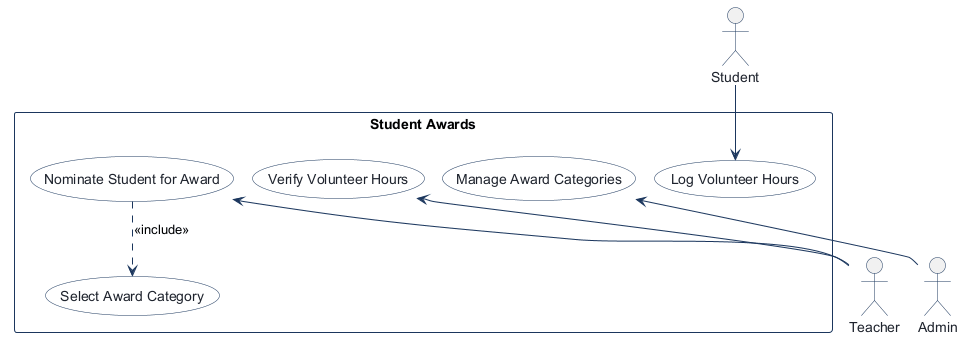

Phase 2 notes: “Earn Volunteer Hours” is represented as **Log Volunteer Hours**; students log entries and teachers verify them before they count toward awards. **Nominate Student for Award** includes **Select Award Category**. Use cases belong only to their named actors; no further missing use case was identified.

## Use cases and actors

| Actor | Use case(s) |
| --- | --- |
| Student | Log Volunteer Hours |
| Teacher | Verify Volunteer Hours; Nominate Student for Award |
| Admin | Manage Award Categories |

**Select Award Category** is included by **Nominate Student for Award**, so it is part of the teacher's nomination flow rather than a separately initiated actor use case.

## Model diagram

Phase 5 revision from the first draft: removed the separate `Admin` entity because students, teachers, and admins all use the shared `User` table with role-specific access. `Nomination.teacher_id` records the submitting teacher, while nullable `reviewer_id` records the admin who later reviews it. The diagram below matches the current SQLModel tables and constraints. The Mermaid source is also saved at [`diagrams/model.mmd`](diagrams/model.mmd).

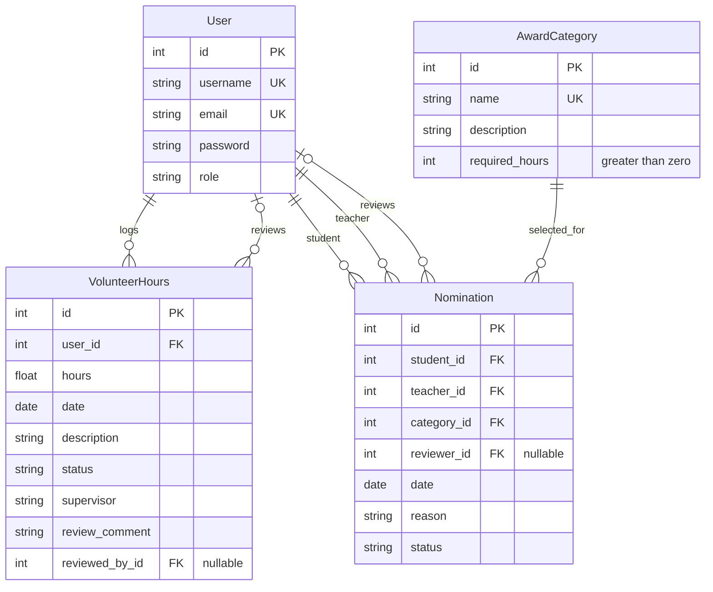

Constraints: `Nomination.student_id` and `Nomination.category_id` are unique as a pair; `AwardCategory.required_hours` must be greater than zero. `reviewed_by_id` and `reviewer_id` are nullable. Assumption: students, teachers, and admins use `User` accounts with role-specific permissions; admin category management is role-based and is not stored as a relationship; each nomination belongs to one student, one submitting teacher, and one award category.

## Wireframes

### Earn Volunteer Hours (Student)

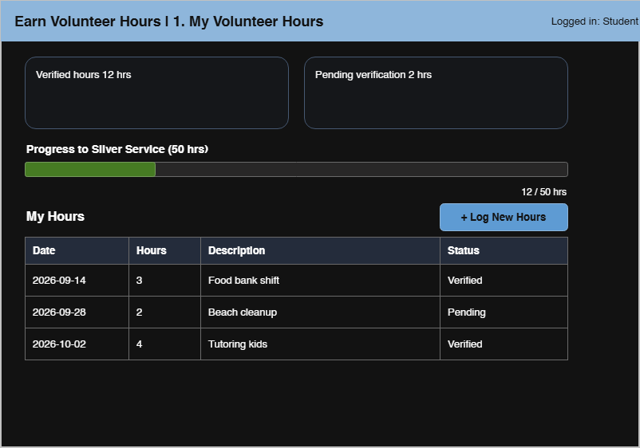

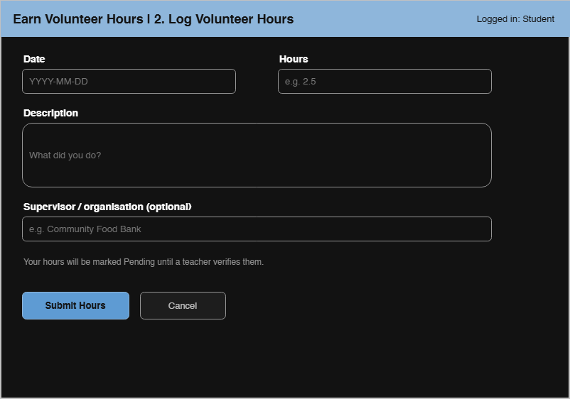

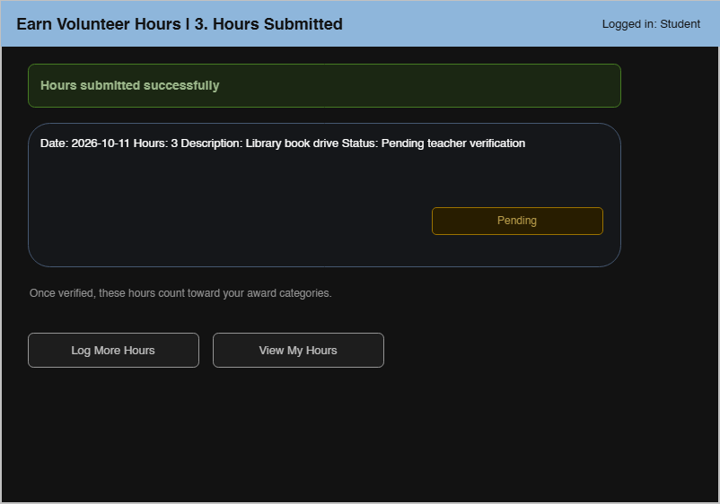

### Verify Volunteer Hours (Teacher)

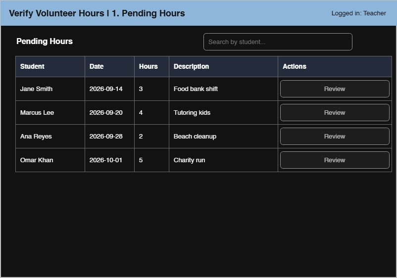

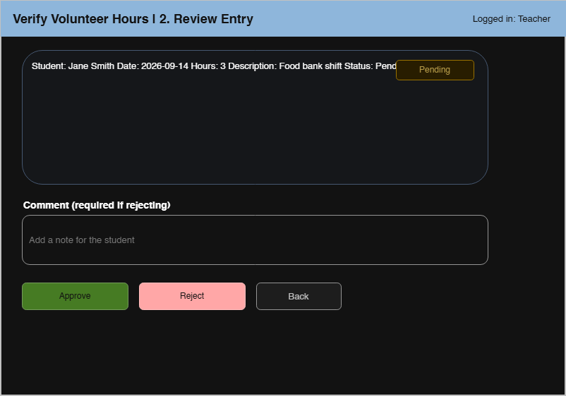

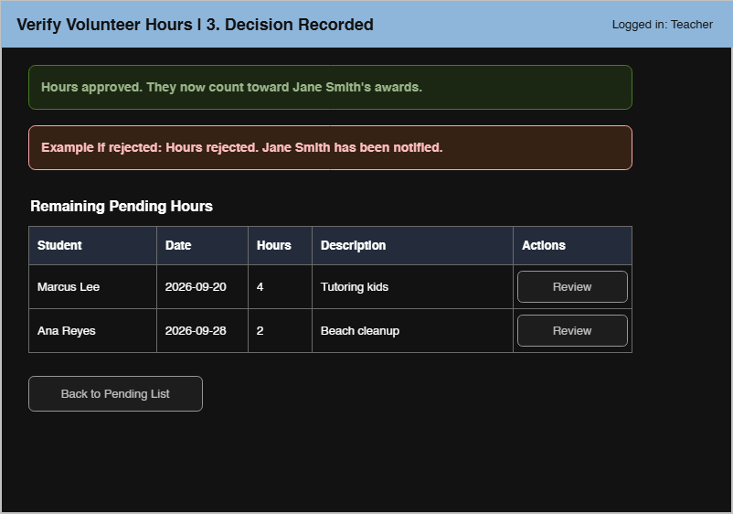

### Nominate Student for Award (Teacher)

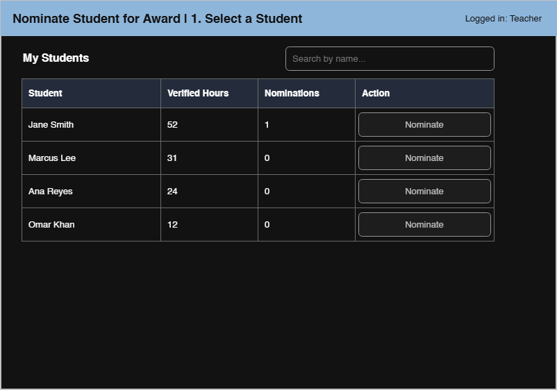

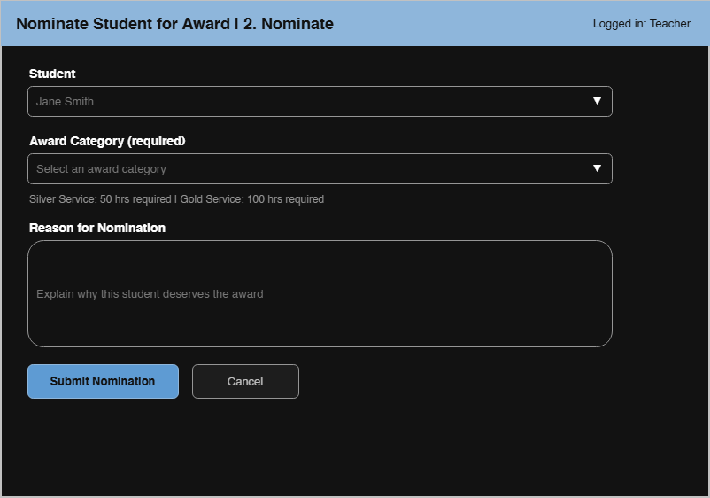

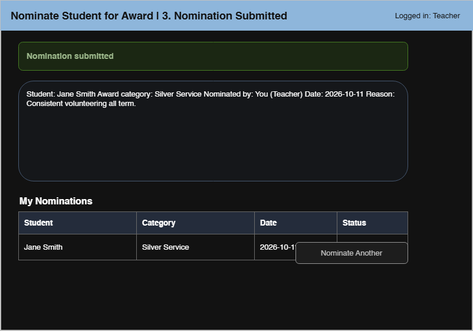

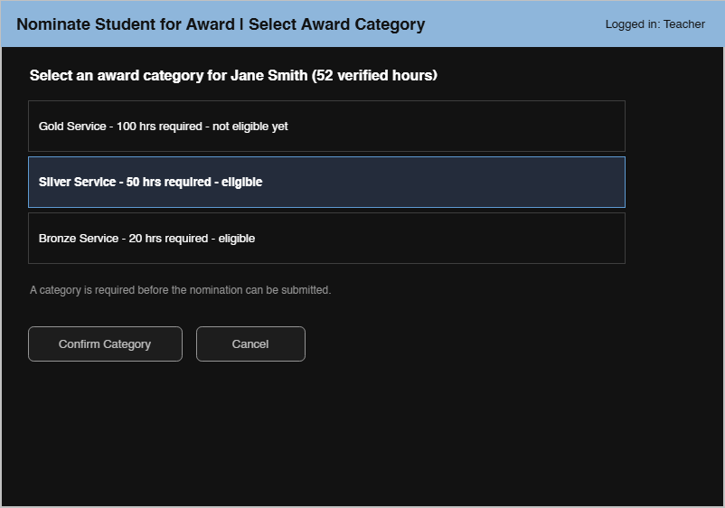

### Manage Award Categories (Admin)

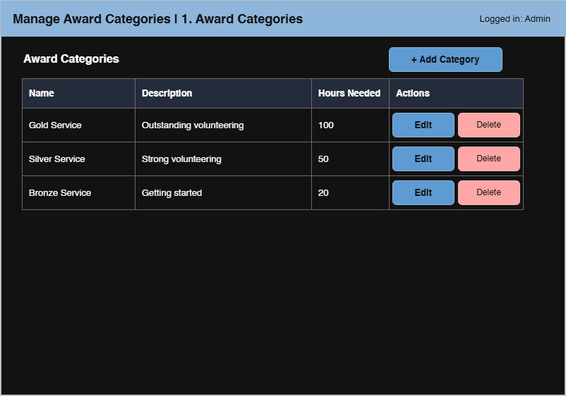

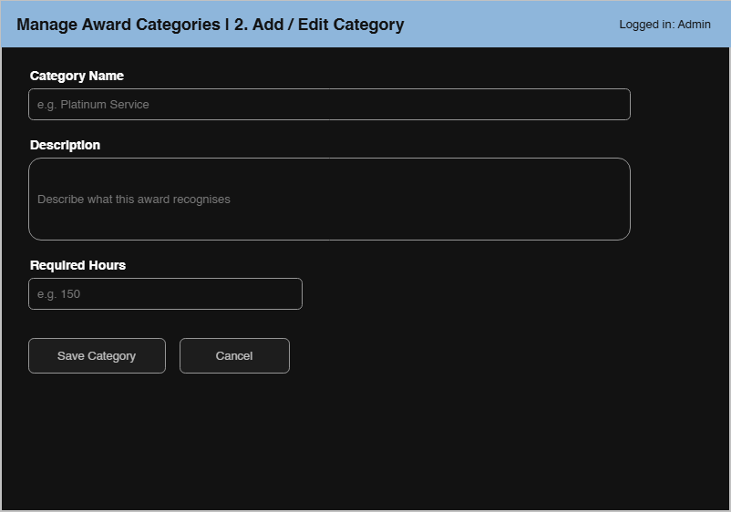

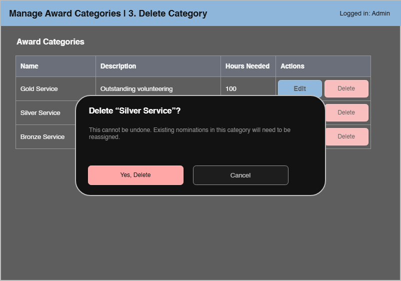

<!-- student-build:wireframe-coverage
use_case: Log Volunteer Hours
image: docs/wireframes/earn-2-log-hours.drawio.png
covered: yes
-->
<!-- student-build:wireframe-coverage
use_case: Verify Volunteer Hours
image: docs/wireframes/verify-1-pending-list.drawio.png
covered: yes
-->
<!-- student-build:wireframe-coverage
use_case: Nominate Student for Award
image: docs/wireframes/nominate-2-nomination-form.drawio.png
covered: yes
-->
<!-- student-build:wireframe-coverage
use_case: Select Award Category
image: docs/wireframes/select-category.drawio.png
covered: yes
-->
<!-- student-build:wireframe-coverage
use_case: Manage Award Categories
image: docs/wireframes/categories-1-list.drawio.png
covered: yes
-->

## Theming

Branding preferences and how they were applied (landing / login / register).

- Colors: modern academic teal and green palette with a light, fresh background and darker green accents.
- Type: clean Source Sans 3 sans-serif typography for both headings and body text.
- Tone: credible, supportive, and achievement-focused for a student recognition app.
- Wordmark: Student Awards.

Applied to the public landing page, sign-in page, and account registration screen with the teal green brand tokens and matching CTA styling. The generic FastStarter starter branding was replaced with the Student Awards identity while leaving the app configuration page available.

## Implementation notes

One named workflow at a time. Include verify notes and polish / model revisions (Phase 5). Do not treat the first build as final.

Volunteer-hour entries link to the signed-in FastStarter `User` account (`VolunteerHours.user_id`) rather than introducing a duplicate student account table. The optional supervisor / organisation and review fields shown or selected for verification are stored on `VolunteerHours`.

For nominations, the teacher selects an award category first, and the confirmed category is preselected on the nomination form. Only categories whose required hours are met by verified hours can be submitted; each student can be nominated once per category. New nominations store status `submitted` (displayed as “Submitted”). The wireframe category tiers are seeded as Bronze Service (20 hours), Silver Service (50), and Gold Service (100). Admins can approve or reject submitted nominations; approved categories appear as awards on the student's hours dashboard, and the admin reviewer is recorded on the nomination. The student reports verifying both admin decisions locally and seeing the approved award on Bob's dashboard.

Phase 5 theme: modern academic teal / green, clean Source Sans 3 sans-serif typography, and a supportive achievement-focused tone. Student Awards branding is applied to the landing, login, register, and authenticated shell.

Workflow: Earn Volunteer Hours (Student) — the learner chose to reuse the signed-in FastStarter account as the student identity, add the optional supervisor / organisation text from the wireframe, and allow fractional hours (the wireframe gives `2.5` as its example). Implemented a student-specific hours overview, pending/verified totals, progress display, entry form, and post-submit confirmation. Entries use the service/repository layers. The student reports running and checking the flow against the three wireframes and says it matches. Polish: the student requested distinct Pending and Verified badges in the hours list, and confirmed the refinement looks right.

Connected use case: Verify Volunteer Hours (Teacher) — use a dedicated `teacher` role and seeded teacher account; display student usernames in the queue; store the required rejection comment and reviewing teacher account on the entry. Approval changes status to verified; rejection changes status to rejected. Implemented the teacher-only pending queue with username search, review page, approve/reject validation, decision result page, and student-visible rejection note. `py -3 manage.py seed` added `teacher / teacherpass` without dropping the existing database. In local testing, Admin was unable to see the queue; the student confirmed this is intentional and chose Teacher-only access. The student confirms the teacher account can access the queue and has verified approval, rejection with a comment, and the resulting student-visible status/note.

Workflow: Nominate Student for Award (Teacher) — implemented the student list, separate eligibility-based category selector, preselected category form, submission confirmation, and teacher nomination history. Eligibility and duplicate checks are coordinated in the service; the model enforces one nomination per student/category and stores status `submitted`. Seeding created the wireframe's Bronze (20), Silver (50), and Gold (100) categories. Additive migrations preserve the existing hours data while extending its review fields and completing the nomination table/index. The student reports the flow works locally, with ineligible categories and duplicate nominations blocked.

Phase 5 Manage Award Categories decisions: category names must be unique; required hours must be positive; deletion is blocked while nominations reference the category. Implemented the admin category table, add/edit form, and deletion confirmation dialog. Service validations and repository persistence enforce the selected rules. Default category descriptions match the wireframe and are backfilled only when still blank. The student reports the category workflow is working and confirmed the follow-up polish for positive-hours/duplicate validation and create/update success feedback behaves as desired.

<!-- student-build:code-check
workflow: Verify Volunteer Hours (Teacher)
form: choice
layer: other
architecture_ok: yes
implement_confidence: 0.78
passed: yes
note: Chose a dedicated teacher role and seeded teacher demo account for verification access.
-->
<!-- student-build:code-check
workflow: Verify Volunteer Hours (Teacher)
form: choice
layer: model
architecture_ok: yes
implement_confidence: 0.78
passed: yes
note: Chose to persist rejection comments on the hour entry for later student visibility.
-->
<!-- student-build:code-check
workflow: Verify Volunteer Hours (Teacher)
form: choice
layer: router
architecture_ok: yes
implement_confidence: 0.78
passed: yes
note: Chose to display student usernames in the teacher queue, matching the existing account model.
-->
<!-- student-build:code-check
workflow: Verify Volunteer Hours (Teacher)
form: choice
layer: model
architecture_ok: yes
implement_confidence: 0.68
passed: yes
note: Chose to store the reviewing teacher's account ID on each decision.
-->
<!-- student-build:code-check
workflow: Verify Volunteer Hours (Teacher)
form: snippet
layer: model
architecture_ok: yes
implement_confidence: 0.68
passed: yes
note: Added an optional User foreign key for the reviewing teacher.
-->
<!-- student-build:code-check
workflow: Verify Volunteer Hours (Teacher)
form: snippet
layer: router
architecture_ok: yes
implement_confidence: 0.68
passed: partial
note: The action handler delegates entry_id, teacher_id, decision, and comment to the service without SQL and redirects to the result path. It initially called a repository method name that did not exist; the service integration was aligned to get_by_id after review.
-->
<!-- student-build:code-check
workflow: Verify Volunteer Hours (Teacher)
form: snippet
layer: service
architecture_ok: yes
implement_confidence: 0.64
passed: partial
note: Correctly enforced pending-only review, approve/reject decisions, required rejection comment, reviewer ID, and repository update; the initial repository lookup name was changed to match the available get_by_id method.
-->

<!-- student-build:code-check
workflow: Nominate Student for Award (Teacher)
form: choice
layer: other
architecture_ok: yes
implement_confidence: 0.84
passed: yes
note: Chose a separate category-selection step that preselects the category in the nomination form.
-->
<!-- student-build:code-check
workflow: Nominate Student for Award (Teacher)
form: choice
layer: service
architecture_ok: yes
implement_confidence: 0.84
passed: yes
note: Chose to block nominations for categories whose verified-hour threshold is not met.
-->
<!-- student-build:code-check
workflow: Nominate Student for Award (Teacher)
form: choice
layer: model
architecture_ok: yes
implement_confidence: 0.84
passed: yes
note: Chose one nomination per student/category pair.
-->
<!-- student-build:code-check
workflow: Nominate Student for Award (Teacher)
form: mcq
layer: service
architecture_ok: yes
implement_confidence: 0.84
passed: yes
note: Correctly placed category eligibility coordination in the service layer.
-->
<!-- student-build:code-check
workflow: Nominate Student for Award (Teacher)
form: open
layer: service
architecture_ok: yes
implement_confidence: 0.84
passed: yes
note: Distinguished repository reads for student hours/category/duplicate state from service eligibility and uniqueness decisions.
-->
<!-- student-build:code-check
workflow: Nominate Student for Award (Teacher)
form: snippet
layer: model
architecture_ok: yes
implement_confidence: 0.84
passed: yes
note: Added nomination student/teacher/category foreign keys, date, reason, and submitted status; unique student/category constraint is wired to the stated rule.
-->
<!-- student-build:code-check
workflow: Nominate Student for Award (Teacher)
form: snippet
layer: router
architecture_ok: yes
implement_confidence: 0.72
passed: partial
note: Handler delegates the submission to NominationService and redirects to confirmation; the first saved snippet had an indentation error that was corrected after review.
-->

<!-- student-build:code-check
workflow: Manage Award Categories (Admin)
form: choice
layer: service
architecture_ok: yes
implement_confidence: 0.72
passed: yes
note: Chose to block deletion if nominations reference a category.
-->
<!-- student-build:code-check
workflow: Manage Award Categories (Admin)
form: choice
layer: model
architecture_ok: yes
implement_confidence: 0.72
passed: yes
note: Chose unique award-category names.
-->
<!-- student-build:code-check
workflow: Manage Award Categories (Admin)
form: mcq
layer: service
architecture_ok: yes
implement_confidence: 0.72
passed: yes
note: Correctly placed the positive required-hours validation decision in the service layer.
-->
<!-- student-build:code-check
workflow: Manage Award Categories (Admin)
form: open
layer: service
architecture_ok: yes
implement_confidence: 0.64
passed: partial
note: Explained service validation and repository persistence for saves but did not address the requested nomination-reference check for deletes.
-->
<!-- student-build:code-check
workflow: Manage Award Categories (Admin)
form: snippet
layer: model
architecture_ok: yes
implement_confidence: 0.64
passed: partial
note: Added unique names and positive hours validation; the initial name field indentation was corrected after review.
-->
<!-- student-build:code-check
workflow: Manage Award Categories (Admin)
form: snippet
layer: repository
architecture_ok: yes
implement_confidence: 0.64
passed: yes
note: Checks for a referencing nomination with a bounded repository query.
-->
<!-- student-build:code-check
workflow: Manage Award Categories (Admin)
form: snippet
layer: service
architecture_ok: yes
implement_confidence: 0.64
passed: yes
note: Service looks up the category, blocks deletion when nominations reference it, and delegates deletion to the repository.
-->
<!-- student-build:code-check
workflow: Manage Award Categories (Admin)
form: snippet
layer: router
architecture_ok: yes
implement_confidence: 0.64
passed: yes
note: Create handler constructs the service, binds form fields, and redirects after delegating category creation.
-->
<!-- student-build:code-check
workflow: Manage Award Categories (Admin)
form: choice
layer: other
architecture_ok: yes
implement_confidence: 0.72
passed: yes
note: Student steered polish toward validation and success/error feedback, then confirmed the refinement met expectations.
-->
<!-- student-build:code-check
workflow: Verify Volunteer Hours (Teacher)
form: snippet
layer: model
architecture_ok: yes
implement_confidence: 0.78
passed: yes
note: Added an optional review_comment field to the VolunteerHours SQLModel.
-->

<!-- student-build:code-check
workflow: Earn Volunteer Hours (Student)
form: snippet
layer: model
architecture_ok: yes
implement_confidence: 0.78
passed: yes
note: Added fields for user link, date, fractional hours, description, pending status, and optional supervisor.
-->

<!-- student-build:code-check
workflow: Earn Volunteer Hours (Student)
form: snippet
layer: router
architecture_ok: yes
implement_confidence: 0.78
passed: yes
note: Handler binds form values and delegates to the service without persistence logic; its signature now matches the service abstraction.
-->

<!-- student-build:code-check
workflow: Earn Volunteer Hours (Student)
form: choice
layer: model
architecture_ok: yes
implement_confidence: 0.78
passed: yes
note: Chose to reuse the existing authenticated User account instead of a separate Student table.
-->
<!-- student-build:code-check
workflow: Earn Volunteer Hours (Student)
form: choice
layer: model
architecture_ok: yes
implement_confidence: 0.78
passed: yes
note: Chose to capture the optional supervisor / organisation field shown in the wireframe.
-->
<!-- student-build:code-check
workflow: Earn Volunteer Hours (Student)
form: choice
layer: model
architecture_ok: yes
implement_confidence: 0.78
passed: yes
note: Chose to accept fractional hour values such as 2.5 and updated the model accordingly.
-->
<!-- student-build:code-check
workflow: Earn Volunteer Hours (Student)
form: snippet
layer: service
architecture_ok: yes
implement_confidence: 0.78
passed: yes
note: Built a VolunteerHours entry from the submitted values, preserved pending status, and delegated persistence to the repository.
-->

<!-- student-build:code-check
workflow: Admin Review Student Award Nominations
form: choice
layer: other
architecture_ok: yes
implement_confidence: 0.78
passed: yes
note: Chose Admin as the nomination reviewer.
-->
<!-- student-build:code-check
workflow: Admin Review Student Award Nominations
form: choice
layer: other
architecture_ok: yes
implement_confidence: 0.78
passed: yes
note: Chose to allow both approval and rejection.
-->
<!-- student-build:code-check
workflow: Admin Review Student Award Nominations
form: choice
layer: other
architecture_ok: yes
implement_confidence: 0.78
passed: yes
note: Chose to show approved awards on the student dashboard.
-->
<!-- student-build:code-check
workflow: Admin Review Student Award Nominations
form: mcq
layer: service
architecture_ok: yes
implement_confidence: 0.78
passed: yes
note: Correctly placed the approval/rejection decision in the service layer.
-->
<!-- student-build:code-check
workflow: Admin Review Student Award Nominations
form: snippet
layer: model
architecture_ok: yes
implement_confidence: 0.38
passed: no
note: Reviewer foreign-key attempt remained misindented after a second pass; Guide corrected it.
-->
<!-- student-build:code-check
workflow: Admin Review Student Award Nominations
form: snippet
layer: router
architecture_ok: yes
implement_confidence: 0.38
passed: partial
note: Attempt called a service without constructing it and used an undefined admin name; Guide completed the thin route.
-->
<!-- student-build:code-check
workflow: Admin Review Student Award Nominations
form: snippet
layer: repository
architecture_ok: yes
implement_confidence: 0.38
passed: yes
note: Loaded the nomination, recorded its decision and reviewer, and committed in the repository.
-->
<!-- student-build:code-check
workflow: Admin Review Student Award Nominations
form: snippet
layer: service
architecture_ok: yes
implement_confidence: 0.38
passed: no
note: Attempt added a nested duplicate method with invalid indentation; Guide corrected the service implementation.
-->

## Deployed app

Phase 6. Public Render URL (not localhost). Markers open this to mark the three workflows.

https://studentawardsselector.onrender.com

Demo accounts are seeded by `python manage.py init --no-drop` at startup. The Docker image now runs the same initialization before starting the app.

## Logins

Every account a marker needs, including extra users you added. Starter accounts:

- bob / bobpass — student (regular_user)
- teacher / teacherpass — teacher
- admin / adminpass — admin

## YouTube URL

https://youtu.be/NXlToZfGpBw

## GitHub

https://github.com/Cyborg2169/comp3613a1

## Session transcripts

Filled when the Guide builds the report: the agent writes chat markdown into `docs/transcripts/`; `python manage.py report` packages them.

Guide packaged **7** chat(s) in `docs/transcripts/` (and `docs/transcripts.zip`).

Index: [docs/transcripts/INDEX.md](transcripts/INDEX.md)

- [`phase-1-start`](transcripts/phase-1-start.md)
- [`phase-2-use-case`](transcripts/phase-2-use-case.md)
- [`phase-3-model`](transcripts/phase-3-model.md)
- [`phase-4-wireframes`](transcripts/phase-4-wireframes.md)
- [`phase-5-implement`](transcripts/phase-5-implement.md)
- [`phase-6-deploy`](transcripts/phase-6-deploy.md)
- [`postman-and-regression-tests`](transcripts/postman-and-regression-tests.md)

## Competency (student-judge)

Filled by Guide from the student-judge run when this report was built.

**Student / session:** Student Awards project
**Artifact:** current project artefacts (`docs/report.md`, `docs/diagrams/`, `docs/wireframes/`) and reconstructed Guide transcript summaries in `docs/transcripts/`
**Phases in evidence:** 1–6 (COMP 3613; Phase 5 polish, Phase 6 deploy; never generic 0–5)

**Judged at:** 2026-10-12T19:21:30Z
**Evidence pass:** re-read current docs/report.md plus the transcript summary files in docs/transcripts/; no native Guide chat history was directly readable in this environment, so the transcript set is a reconstruction from the project artefacts and report metadata

### Totals
| | Count / value |
|--|--|
| Metrics on rubric | 12 (M1–M12) |
| N/A (excluded) | 0 |
| Metrics scored | 12 |
| Scoreable max | 48 |
| Awarded total | 46 / 48 |
| **Overall (avg of scored)** | **3.83 / 4** |
| Impression mark | 19 / 20 |

## Scorecard

| ID | Metric | Score / 4 | In avg | Evidence |
|----|--------|----------:|:------:|----------|
| M1 | Phase discipline | 4 | yes | Project, workflows, ERD, wireframes, and Phase 5 polish are all reflected in the report and deployment sections; the report clearly distinguishes the phase progression and deployment timing. |
| M2 | Problem framing | 4 | yes | Student Awards, three named workflows, use-case interpretation, and the project framing are all explicit in the report and diagrams. |
| M3 | Decision ownership | 4 | yes | The report documents the student’s decisions on model assumptions, role ownership, verification steps, category rules, and local workflow checks. |
| M4 | Artefact-before-code | 4 | yes | ERD and wireframe files are present and the implementation notes align to them; the app was built against those artefacts rather than an unrelated product. |
| M5 | Verification habit | 3 | yes | The report includes explicit local verification notes and reported observations against the wireframes. The evidence is solid but not a full browser-by-browser final walkthrough of every flow. |
| M6 | Assignment fit | 4 | yes | The report demonstrates theme work, layered implementation logic, workflow-by-workflow completion, and a proper deployed app URL; no architecture red flag is evident in the recorded notes. |
| M7 | Slice explanation | 3 | yes | The report contains route/service/repository checks and implementation notes that explain workflow logic and architecture decisions. |
| M8 | Prompt quality | 4 | yes | Phase-tagged sections and concise workflow notes are present throughout the report and transcript summaries. |
| M9 | Response to pushback | 4 | yes | The project shows iterative model and workflow revisions, including local polish and status updates, rather than accepting the first build pass uncritically. |
| M10 | Integrity | 4 | yes | No evidence of edited skills or malicious report manipulation; the material shows a coherent build trail and a complete project record. |
| M11 | Provenance continuity | 4 | yes | The workflow decisions and model revisions follow the same project thread from Phase 1 through deployment. |
| M12 | Sincerity trajectory | 4 | yes | No suspicion blocks were present in the accessible evidence; the project record is consistent and self-explanatory. |

## Strengths
- Clear project selection and named workflow framing: Student Awards with three core workflows.
- Strong artefact coverage: use-case diagram, ERD, wireframes, theming, implementation notes, and deployment information are all in the report.
- Good Phase 5 polish evidence: the report includes role-based workflows, status handling, badge refinements, and model revisions rather than a one-pass build.
- Solid end-state documentation: deployed URL, login credentials, and YouTube demo link are all included.
- The evidence shows a coherent progression from design to deploy without obvious process drift.

## Gaps (priority order)
1. No direct native chat history was available in this environment; the transcript set was reconstructed from the report and project artefacts. This is not a process failure in the project, but it does limit verbatim transcript depth.

## Phase gate status
| Phase | Status | Note |
|-------|--------|------|
| 1 | met | Project and three workflows are clearly named and documented. |
| 2 | met | Use-case diagram and report notes are present. |
| 3 | met | ERD and model assumptions are documented. |
| 4 | met | Wireframes are embedded and coverage comments are included. |
| 5 | met | Theming, build, polish, and workflow verification are documented; local polish is clearly present. |
| 6 | met | Render URL and seed logins are in the report and the app is documented as deployed. |

## Recommended next practice
- Keep the report and transcript package as the primary evidence bundle; when a future judge pass reopens this project, re-read the native chats if they become available and replace this reconstructed summary with the live transcript logs.

## Integrity note
- Clean
- No evidence of external-lLM laundering or edited skills in the accessible record.

## Provenance flags
- None in current evidence.

## Sincerity log summary
- Blocks found: 0
- max round: N/A
- min/mean/final confidence: N/A
- trend: N/A
- cleared: N/A

## Skips
- Skips: not visible in accessible evidence

## Skill integrity

Course skills are hashed at export and compared to `.agents/skills.lock.json`. Do not edit `.agents/skills/`, `.cursor/skills/`, or `AGENTS.md`.

- Status: **pass**
- Root: `e84cd692d0b85eefe546385661958c27d07e8be6c5176a82012f68ccff5c8beb`
- none

## Test plans

### Unit test plan

Unit tests isolate service rules using mock repositories; they do not depend on the configured local or deployed database.

| Area | Planned checks |
| --- | --- |
| Volunteer-hour service | Positive fractional hours create pending entries; zero/negative hours are rejected; overview totals include only verified and pending entries; approvals and rejections persist reviewer/comment; invalid, repeated, or comment-free reviews are rejected. |
| Nomination service | Submission trims the reason and starts as submitted; verified-hour threshold, existing nomination, and nonblank reason are enforced; category options reflect each verified-hour threshold. |
| Award-category service | Names/descriptions are trimmed; blank/duplicate names and nonpositive thresholds are rejected; referenced categories cannot be deleted. |

### Integration test plan

Use FastAPI's test client with a fresh in-memory SQLite database per test. Requests exercise the route, authentication dependency, service, repository, and database layers together.

| Flow | Planned checks |
| --- | --- |
| API basics | `/health` returns the health JSON; `/api/users` returns public user fields without password values. |
| Earn and verify hours | Student submits hours; teacher sees the pending entry and approves it; student's dashboard reflects verified hours; after approval the entry leaves the teacher queue, a second approval attempt is refused, and the student's verified total stays 2.5. |
| Reject hours | A rejection without a comment is refused; a valid rejection saves the comment, appears on the student's dashboard, and is excluded from verified totals. |
| Nominate student | Teacher cannot nominate below the verified-hours threshold; an eligible nomination succeeds; a duplicate student/category nomination is refused; an admin approval appears as an award on the student's dashboard. |
| Manage categories | Admin creates, updates, and deletes an unreferenced category; deletion is prevented when a nomination references it. |
| Authorization | A student cannot access the teacher verification queue. |

### User acceptance test plan

Run these tasks in the browser against the deployed or locally initialized app. Use the existing demo users (`bob`, `teacher`, and `admin`) and reset only a disposable test database before testing. Compare each screen and outcome to its linked wireframe.

| ID | Actor / wireframe reference | User task and success criteria |
| --- | --- | --- |
| UAT-01 | Student — [My Hours](wireframes/earn-1-my-hours.drawio.png), [Log Hours](wireframes/earn-2-log-hours.drawio.png), [Hours Submitted](wireframes/earn-3-hours-submitted.drawio.png) | Sign in as Bob and submit 2.5 volunteer hours with a date, description, and optional supervisor. Confirm the submission page shows the details and pending status, then confirm the dashboard shows the pending entry and pending total. |
| UAT-02 | Teacher — [Pending List](wireframes/verify-1-pending-list.drawio.png), [Review Entry](wireframes/verify-2-review-entry.drawio.png), [Decision Recorded](wireframes/verify-3-decision-recorded.drawio.png) | Sign in as Teacher, find Bob's entry, and approve it. Confirm the result page records the decision and Bob's dashboard counts it as verified. |
| UAT-03 | Teacher and Student — same verification wireframes and UAT-01 dashboard | Submit another entry and reject it with a clear comment. Confirm a rejection without a comment is not accepted; after a valid rejection, confirm Bob sees the rejected status/comment and the hours are not included in the verified total. |
| UAT-04 | Teacher — [Student List](wireframes/nominate-1-student-list.drawio.png), [Nomination Form](wireframes/nominate-2-nomination-form.drawio.png), [Nomination Submitted](wireframes/nominate-3-nomination-submitted.drawio.png), [Category Selection](wireframes/select-category.drawio.png) | Ensure Bob has at least 20 verified hours. Select Bob and Bronze Service, submit a reason, and confirm the submitted page shows the student, category, reason, and submitted status. Confirm an ineligible category is unavailable and a duplicate nomination is blocked. |
| UAT-05 | Admin — [Category List](wireframes/categories-1-list.drawio.png), [Add/Edit](wireframes/categories-2-add-edit.drawio.png), [Delete Confirmation](wireframes/categories-3-delete-confirm.drawio.png) | Create a category with a positive threshold, edit it, and delete it. Confirm the list reflects the changes; confirm a category referenced by a nomination cannot be deleted. |

### Test reporting and execution evidence

Automated tests are run from the repository root with `python -m pytest`. The integration tests use only disposable in-memory SQLite databases and do not reset or modify `database.db`.

| Evidence | Status |
| --- | --- |
| Unit-test CLI result screenshot | Capture the passing `python -m pytest -q tests/test_services.py` output in the terminal and attach it to the final PDF. |
| Integration-test CLI result screenshot | Capture the passing `python -m pytest -q tests/test_integration.py` output in the terminal and attach it to the final PDF. |
| Postman collection run screenshot | Import [`Student-Awards-API.postman_collection.json`](../postman/Student-Awards-API.postman_collection.json), set `baseUrl` to the running app, run the collection, and attach the passing results in the final PDF. |
| UAT execution report | The UAT cases above are a plan only; record tester, date, Pass/Fail, and observations after a person completes each browser task. No manual UAT result is claimed here. |

Automated test results:

| Suite | Command | Result |
| --- | --- | --- |
| Unit | `python -m pytest -q tests/test_services.py` | 21 passed |
| Integration | `python -m pytest -q tests/test_integration.py` | 7 passed |

Both pytest commands emitted one Starlette/httpx deprecation warning from the installed test-client dependency; neither suite failed. The tests exposed and led to a fix for the missing `NominationService.list_approved_for_student` delegation used by the student dashboard. The Postman Collection Runner run passed: 13 of 13 requests' tests passed.

UAT execution record — complete after the browser tasks above:

| UAT ID | Result (Pass / Fail / Not run) | Tester and date | Observations / evidence |
| --- | --- | --- | --- |
| UAT-01 | Not run |  |  |
| UAT-02 | Not run |  |  |
| UAT-03 | Not run |  |  |
| UAT-04 | Not run |  |  |
| UAT-05 | Not run |  |  |
