# COMP 3613 Assignment 1

Draft this file with the Guide. **Update it after every phase milestone** before you pause. The use-case diagram is a UML PNG at `docs/diagrams/use-case.png`, linked from this file as `diagrams/use-case.png` (path relative to `docs/report.md`). The model diagram is Mermaid. **Embed wireframe images** as `wireframes/<file>` (files live in `docs/wireframes/`).

Do not put your student ID in this file if you will commit it. The PDF cover adds your name and ID at export time.

## Assigned project

Student Awards

## Three workflows

### 1.
Earn Volunteer Hours (Student)

### 2.
Nominate Student for Award (Teacher)

### 3.
Manage Award Categories (Admin)

## Use case diagram

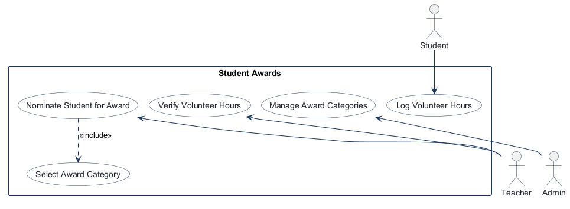

Phase 2 notes: “Earn Volunteer Hours” is represented as **Log Volunteer Hours**; students log entries and teachers verify them before they count toward awards. **Nominate Student for Award** includes **Select Award Category**. Use cases belong only to their named actors; no further missing use case was identified.

## Model diagram

First draft. Update this section in Phase 5 when polish revises the model, and note what changed.

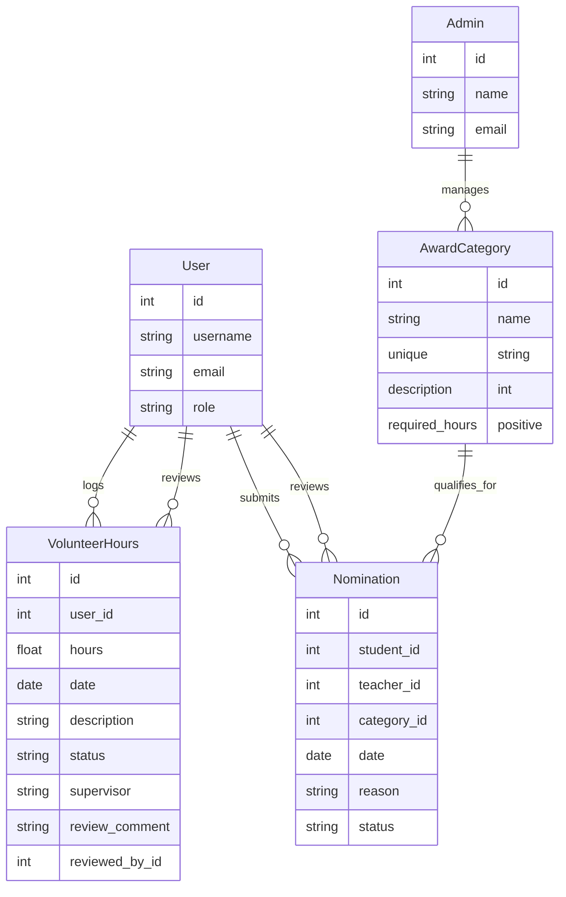

Assumption: students, teachers, and admins use the existing account (`User`) with role-specific permissions; each nomination belongs to one student, one teacher, and one award category; admin manages categories but does not directly log hours or nominate students.

Phase 5 implementation mapping: volunteer-hour entries link to the signed-in FastStarter `User` account (`VolunteerHours.user_id`) rather than introducing a duplicate student account table. The optional supervisor / organisation and review fields shown or selected for verification are stored on `VolunteerHours`.

Phase 5 Nomination decisions: use the separate category selector first and preselect the confirmed category on the nomination form; only categories whose required hours are met by verified hours can be submitted; allow only one nomination per student/category; new nominations store status `submitted` (displayed as “Submitted”). The wireframe category tiers are seeded as Bronze Service (20 hours), Silver Service (50), and Gold Service (100).

## Wireframes

### Earn Volunteer Hours (Student)

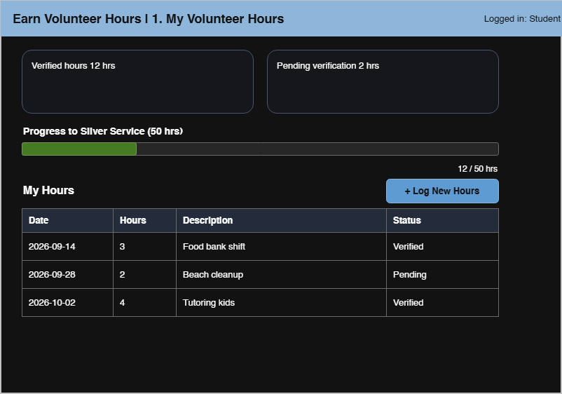

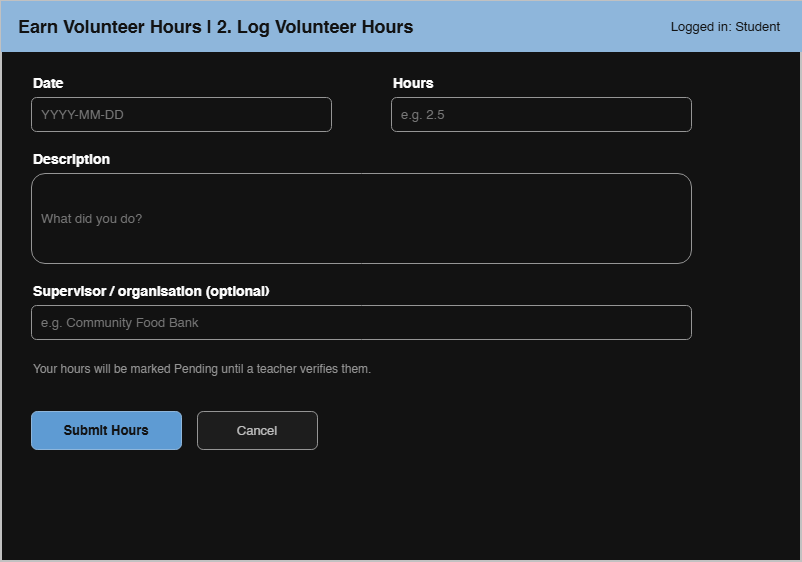

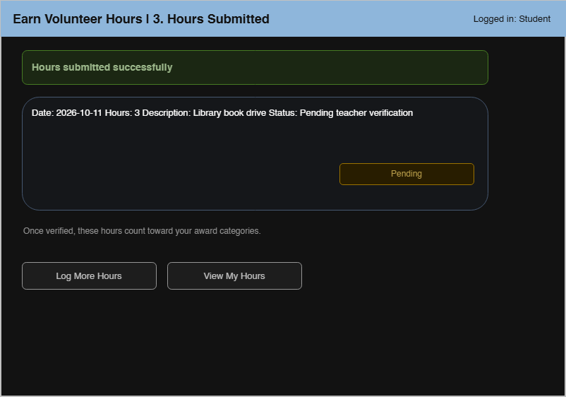

### Verify Volunteer Hours (Teacher)

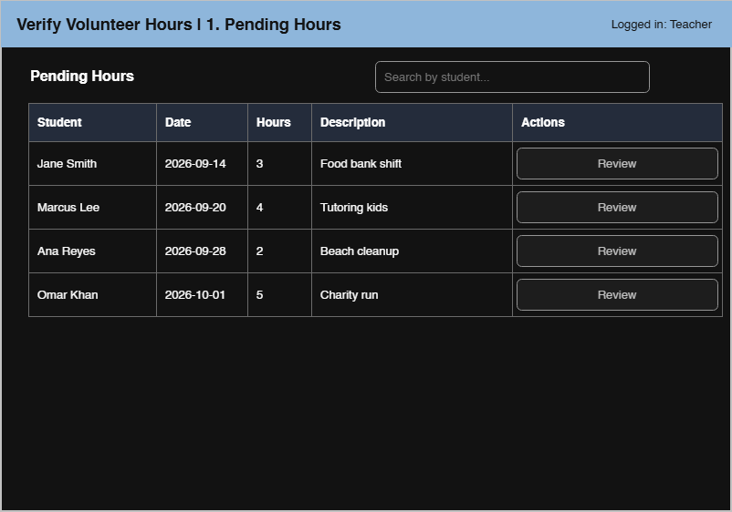

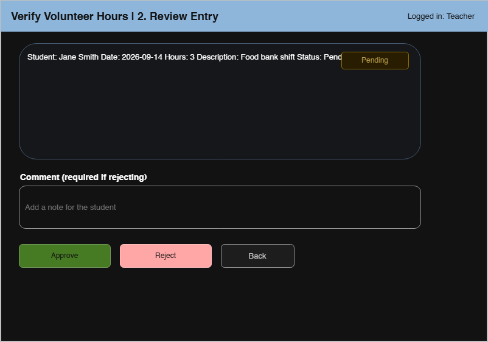

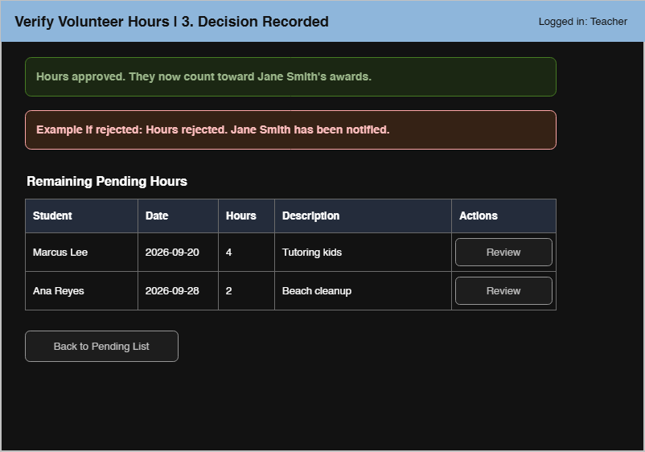

### Nominate Student for Award (Teacher)

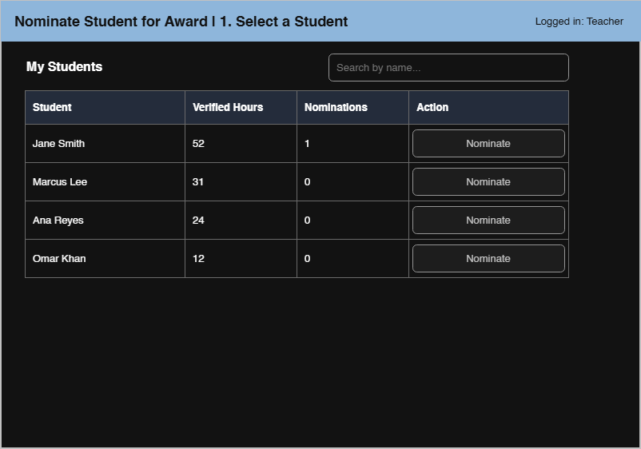

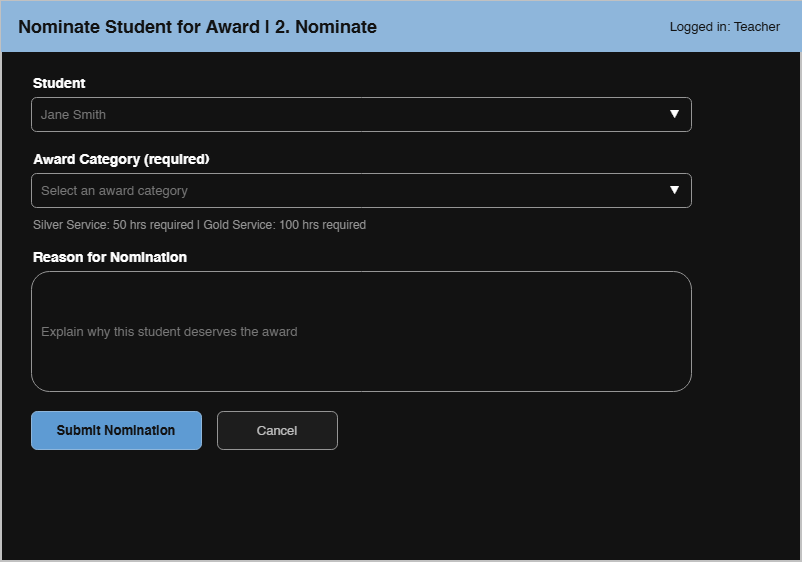

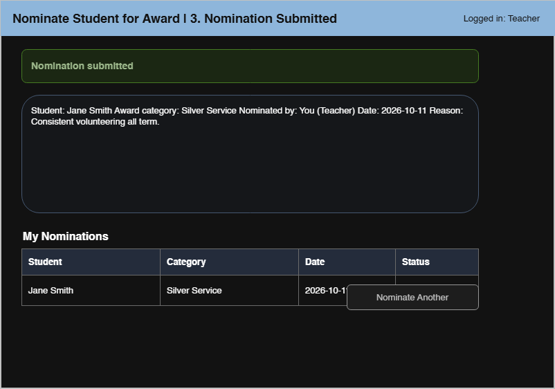

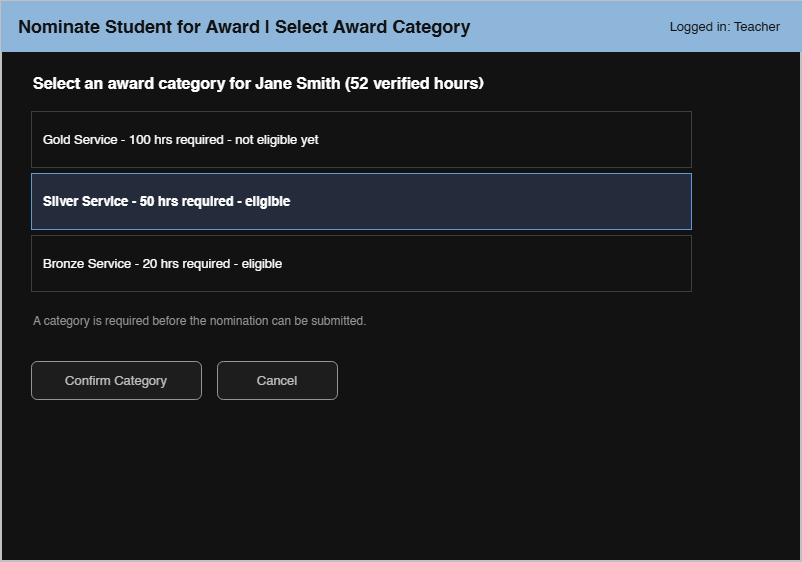

### Manage Award Categories (Admin)

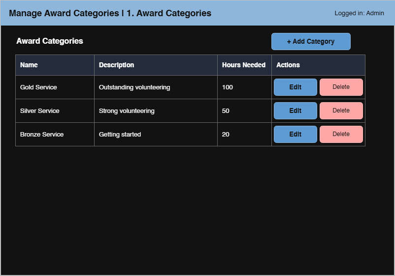

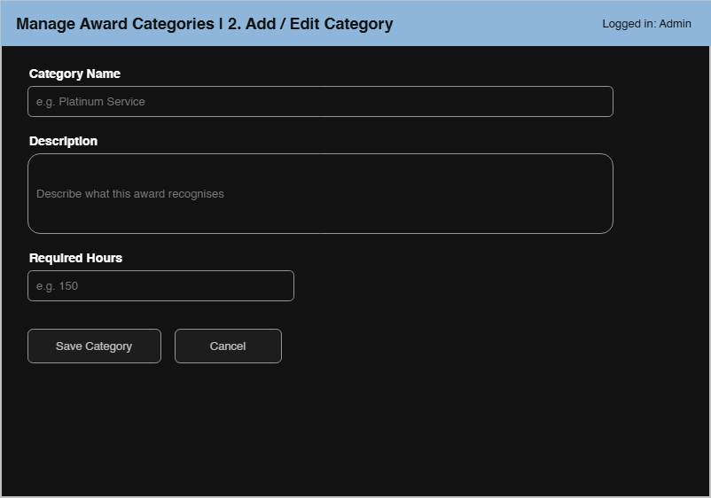

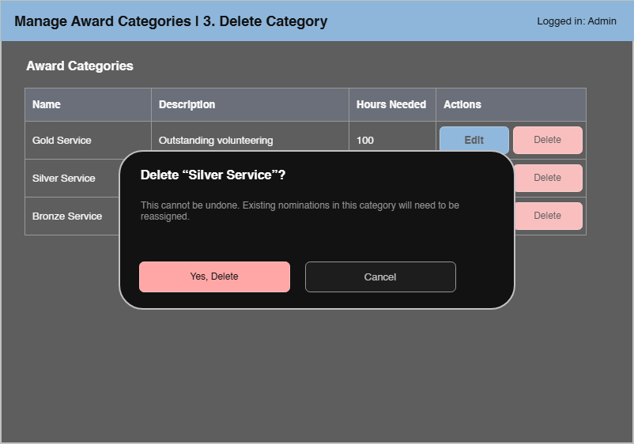

<!-- student-build:wireframe-coverage
use_case: Log Volunteer Hours
image: docs/wireframes/earn-2-log-hours.drawio.png
covered: yes
-->
<!-- student-build:wireframe-coverage
use_case: Verify Volunteer Hours
image: docs/wireframes/verify-1-pending-list.drawio.png
covered: yes
-->
<!-- student-build:wireframe-coverage
use_case: Nominate Student for Award
image: docs/wireframes/nominate-2-nomination-form.drawio.png
covered: yes
-->
<!-- student-build:wireframe-coverage
use_case: Select Award Category
image: docs/wireframes/select-category.drawio.png
covered: yes
-->
<!-- student-build:wireframe-coverage
use_case: Manage Award Categories
image: docs/wireframes/categories-1-list.drawio.png
covered: yes
-->

## Theming

Branding preferences and how they were applied (landing / login / register).

- Colors: modern academic teal and green palette with a light, fresh background and darker green accents.
- Type: clean Source Sans 3 sans-serif typography for both headings and body text.
- Tone: credible, supportive, and achievement-focused for a student recognition app.
- Wordmark: Student Awards.

Applied to the public landing page, sign-in page, and account registration screen with the teal green brand tokens and matching CTA styling. The generic FastStarter starter branding was replaced with the Student Awards identity while leaving the app configuration page available.

## Implementation notes

One named workflow at a time. Include verify notes and polish / model revisions (Phase 5). Do not treat the first build as final.

Phase 5 theme: modern academic teal / green, clean Source Sans 3 sans-serif typography, and a supportive achievement-focused tone. Student Awards branding is applied to the landing, login, register, and authenticated shell.

Workflow: Earn Volunteer Hours (Student) — the learner chose to reuse the signed-in FastStarter account as the student identity, add the optional supervisor / organisation text from the wireframe, and allow fractional hours (the wireframe gives `2.5` as its example). Implemented a student-specific hours overview, pending/verified totals, progress display, entry form, and post-submit confirmation. Entries use the service/repository layers. The student reports running and checking the flow against the three wireframes and says it matches. Polish: the student requested distinct Pending and Verified badges in the hours list, and confirmed the refinement looks right.

Connected use case: Verify Volunteer Hours (Teacher) — use a dedicated `teacher` role and seeded teacher account; display student usernames in the queue; store the required rejection comment and reviewing teacher account on the entry. Approval changes status to verified; rejection changes status to rejected. Implemented the teacher-only pending queue with username search, review page, approve/reject validation, decision result page, and student-visible rejection note. `py -3 manage.py seed` added `teacher / teacherpass` without dropping the existing database. In local testing, Admin was unable to see the queue; the student confirmed this is intentional and chose Teacher-only access. The student confirms the teacher account can access the queue and has verified approval, rejection with a comment, and the resulting student-visible status/note.

Workflow: Nominate Student for Award (Teacher) — implemented the student list, separate eligibility-based category selector, preselected category form, submission confirmation, and teacher nomination history. Eligibility and duplicate checks are coordinated in the service; the model enforces one nomination per student/category and stores status `submitted`. Seeding created the wireframe's Bronze (20), Silver (50), and Gold (100) categories. Additive migrations preserve the existing hours data while extending its review fields and completing the nomination table/index. The student reports the flow works locally, with ineligible categories and duplicate nominations blocked.

Phase 5 Manage Award Categories decisions: category names must be unique; required hours must be positive; deletion is blocked while nominations reference the category. Implemented the admin category table, add/edit form, and deletion confirmation dialog. Service validations and repository persistence enforce the selected rules. Default category descriptions match the wireframe and are backfilled only when still blank. The student reports the category workflow is working and confirmed the follow-up polish for positive-hours/duplicate validation and create/update success feedback behaves as desired.

<!-- student-build:code-check
workflow: Verify Volunteer Hours (Teacher)
form: choice
layer: other
architecture_ok: yes
implement_confidence: 0.78
passed: yes
note: Chose a dedicated teacher role and seeded teacher demo account for verification access.
-->
<!-- student-build:code-check
workflow: Verify Volunteer Hours (Teacher)
form: choice
layer: model
architecture_ok: yes
implement_confidence: 0.78
passed: yes
note: Chose to persist rejection comments on the hour entry for later student visibility.
-->
<!-- student-build:code-check
workflow: Verify Volunteer Hours (Teacher)
form: choice
layer: router
architecture_ok: yes
implement_confidence: 0.78
passed: yes
note: Chose to display student usernames in the teacher queue, matching the existing account model.
-->
<!-- student-build:code-check
workflow: Verify Volunteer Hours (Teacher)
form: choice
layer: model
architecture_ok: yes
implement_confidence: 0.68
passed: yes
note: Chose to store the reviewing teacher's account ID on each decision.
-->
<!-- student-build:code-check
workflow: Verify Volunteer Hours (Teacher)
form: snippet
layer: model
architecture_ok: yes
implement_confidence: 0.68
passed: yes
note: Added an optional User foreign key for the reviewing teacher.
-->
<!-- student-build:code-check
workflow: Verify Volunteer Hours (Teacher)
form: snippet
layer: router
architecture_ok: yes
implement_confidence: 0.68
passed: partial
note: The action handler delegates entry_id, teacher_id, decision, and comment to the service without SQL and redirects to the result path. It initially called a repository method name that did not exist; the service integration was aligned to get_by_id after review.
-->
<!-- student-build:code-check
workflow: Verify Volunteer Hours (Teacher)
form: snippet
layer: service
architecture_ok: yes
implement_confidence: 0.64
passed: partial
note: Correctly enforced pending-only review, approve/reject decisions, required rejection comment, reviewer ID, and repository update; the initial repository lookup name was changed to match the available get_by_id method.
-->

<!-- student-build:code-check
workflow: Nominate Student for Award (Teacher)
form: choice
layer: other
architecture_ok: yes
implement_confidence: 0.84
passed: yes
note: Chose a separate category-selection step that preselects the category in the nomination form.
-->
<!-- student-build:code-check
workflow: Nominate Student for Award (Teacher)
form: choice
layer: service
architecture_ok: yes
implement_confidence: 0.84
passed: yes
note: Chose to block nominations for categories whose verified-hour threshold is not met.
-->
<!-- student-build:code-check
workflow: Nominate Student for Award (Teacher)
form: choice
layer: model
architecture_ok: yes
implement_confidence: 0.84
passed: yes
note: Chose one nomination per student/category pair.
-->
<!-- student-build:code-check
workflow: Nominate Student for Award (Teacher)
form: mcq
layer: service
architecture_ok: yes
implement_confidence: 0.84
passed: yes
note: Correctly placed category eligibility coordination in the service layer.
-->
<!-- student-build:code-check
workflow: Nominate Student for Award (Teacher)
form: open
layer: service
architecture_ok: yes
implement_confidence: 0.84
passed: yes
note: Distinguished repository reads for student hours/category/duplicate state from service eligibility and uniqueness decisions.
-->
<!-- student-build:code-check
workflow: Nominate Student for Award (Teacher)
form: snippet
layer: model
architecture_ok: yes
implement_confidence: 0.84
passed: yes
note: Added nomination student/teacher/category foreign keys, date, reason, and submitted status; unique student/category constraint is wired to the stated rule.
-->
<!-- student-build:code-check
workflow: Nominate Student for Award (Teacher)
form: snippet
layer: router
architecture_ok: yes
implement_confidence: 0.72
passed: partial
note: Handler delegates the submission to NominationService and redirects to confirmation; the first saved snippet had an indentation error that was corrected after review.
-->

<!-- student-build:code-check
workflow: Manage Award Categories (Admin)
form: choice
layer: service
architecture_ok: yes
implement_confidence: 0.72
passed: yes
note: Chose to block deletion if nominations reference a category.
-->
<!-- student-build:code-check
workflow: Manage Award Categories (Admin)
form: choice
layer: model
architecture_ok: yes
implement_confidence: 0.72
passed: yes
note: Chose unique award-category names.
-->
<!-- student-build:code-check
workflow: Manage Award Categories (Admin)
form: mcq
layer: service
architecture_ok: yes
implement_confidence: 0.72
passed: yes
note: Correctly placed the positive required-hours validation decision in the service layer.
-->
<!-- student-build:code-check
workflow: Manage Award Categories (Admin)
form: open
layer: service
architecture_ok: yes
implement_confidence: 0.64
passed: partial
note: Explained service validation and repository persistence for saves but did not address the requested nomination-reference check for deletes.
-->
<!-- student-build:code-check
workflow: Manage Award Categories (Admin)
form: snippet
layer: model
architecture_ok: yes
implement_confidence: 0.64
passed: partial
note: Added unique names and positive hours validation; the initial name field indentation was corrected after review.
-->
<!-- student-build:code-check
workflow: Manage Award Categories (Admin)
form: snippet
layer: repository
architecture_ok: yes
implement_confidence: 0.64
passed: yes
note: Checks for a referencing nomination with a bounded repository query.
-->
<!-- student-build:code-check
workflow: Manage Award Categories (Admin)
form: snippet
layer: service
architecture_ok: yes
implement_confidence: 0.64
passed: yes
note: Service looks up the category, blocks deletion when nominations reference it, and delegates deletion to the repository.
-->
<!-- student-build:code-check
workflow: Manage Award Categories (Admin)
form: snippet
layer: router
architecture_ok: yes
implement_confidence: 0.64
passed: yes
note: Create handler constructs the service, binds form fields, and redirects after delegating category creation.
-->
<!-- student-build:code-check
workflow: Manage Award Categories (Admin)
form: choice
layer: other
architecture_ok: yes
implement_confidence: 0.72
passed: yes
note: Student steered polish toward validation and success/error feedback, then confirmed the refinement met expectations.
-->
<!-- student-build:code-check
workflow: Verify Volunteer Hours (Teacher)
form: snippet
layer: model
architecture_ok: yes
implement_confidence: 0.78
passed: yes
note: Added an optional review_comment field to the VolunteerHours SQLModel.
-->

<!-- student-build:code-check
workflow: Earn Volunteer Hours (Student)
form: snippet
layer: model
architecture_ok: yes
implement_confidence: 0.78
passed: yes
note: Added fields for user link, date, fractional hours, description, pending status, and optional supervisor.
-->

<!-- student-build:code-check
workflow: Earn Volunteer Hours (Student)
form: snippet
layer: router
architecture_ok: yes
implement_confidence: 0.78
passed: yes
note: Handler binds form values and delegates to the service without persistence logic; its signature now matches the service abstraction.
-->

<!-- student-build:code-check
workflow: Earn Volunteer Hours (Student)
form: choice
layer: model
architecture_ok: yes
implement_confidence: 0.78
passed: yes
note: Chose to reuse the existing authenticated User account instead of a separate Student table.
-->
<!-- student-build:code-check
workflow: Earn Volunteer Hours (Student)
form: choice
layer: model
architecture_ok: yes
implement_confidence: 0.78
passed: yes
note: Chose to capture the optional supervisor / organisation field shown in the wireframe.
-->
<!-- student-build:code-check
workflow: Earn Volunteer Hours (Student)
form: choice
layer: model
architecture_ok: yes
implement_confidence: 0.78
passed: yes
note: Chose to accept fractional hour values such as 2.5 and updated the model accordingly.
-->
<!-- student-build:code-check
workflow: Earn Volunteer Hours (Student)
form: snippet
layer: service
architecture_ok: yes
implement_confidence: 0.78
passed: yes
note: Built a VolunteerHours entry from the submitted values, preserved pending status, and delegated persistence to the repository.
-->

## Deployed app

Phase 6. Public Render URL (not localhost). Markers open this to mark the three workflows.

https://studentawardsselector.onrender.com

## Logins

Every account a marker needs, including extra users you added. Starter accounts:

- bob / bobpass — student (regular_user)
- teacher / teacherpass — teacher
- admin / adminpass — admin

## YouTube URL

## Session transcripts

Filled when the Guide builds the report: the agent writes each Guide chat to `docs/transcripts/<slug>.md` (Copilot Agent, Cursor, or OpenCode). `python manage.py report` packages them. Do not paste chats here during the build.

## Competency (student-judge)

Filled when the report is built. Guide runs student-judge, writes `docs/judge.md`, and export appends the scorecard here.

## Skill integrity

Filled by `python manage.py report`. Do not edit the course skills.
